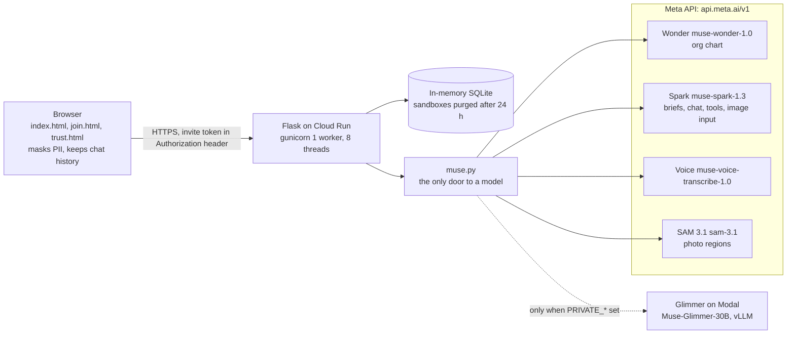
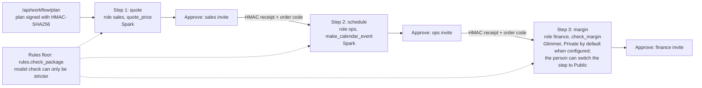
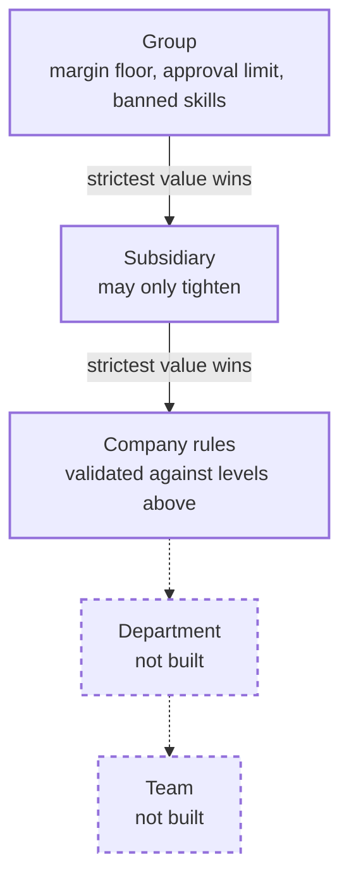
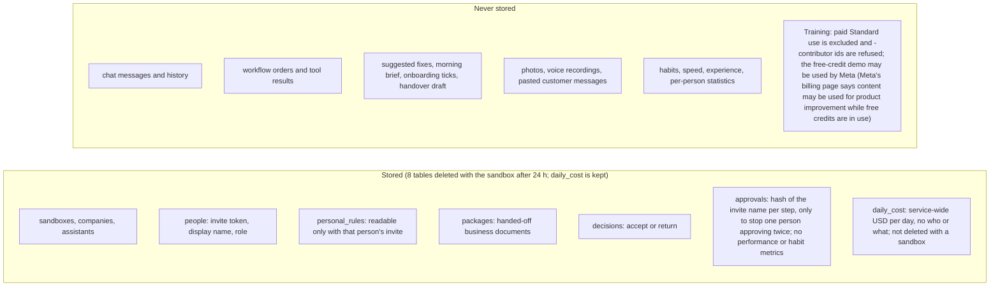

# Role Assistant Foundry: architecture

Role Assistant Foundry builds role-based AI assistants for small companies on Meta Muse models. Rules decide structure (org chart validity, skill lists, approval limits); the model only writes words and picks tool arguments. A visual version of these four views is in `docs/architecture.html`.

## (a) Request path

Any model failure returns `demo_mode: true` with a label; `FAKE_AI=1` forces demo mode. Model ids ending in `-contributor` are refused. Private mode never falls back to the Meta API.

Source: `static/*.html`, `static/app.js`, `static/join.js`, `app.py`, `store.py`, `muse.py`, `chart.py`, `vision.py`, `voice.py`, `sam.py`, `scripts/private_modal.py`, `scripts/deploy.ps1`, `Dockerfile`.

## (b) Order workflow

The model picks tool arguments, code computes the numbers (`tools.py`). `/api/workflow/step` runs a step only if every earlier step has a valid receipt. An invite approves only its own role's step (409 `wrong_role`, reason `other_role`), and one named person cannot approve two steps of the same order (409 `wrong_role`, reason `same_person`). The order code (plan, signature, roles, receipts) is copied by the approver and pasted by the next role; pasting grants nothing the signatures do not. Orders and tool results stay in the browser.

Source: `workflow.py`, `app.py`, `rules.py`, `tools.py`, `store.py` (`record_approval`), `static/join.js`.

## (c) Hierarchy

A child may keep or raise `margin_floor_pct`, keep or lower `escalation_usd`, and must keep every parent ban in `banned_skills` (it may add more). `validate_child_rules` rejects a looser child; `bind_levels` applies the strictest value.

Source: `rules.py` (`LEVEL_IDS`, `validate_child_rules`, `bind_levels`), `app.py` (`/api/levels`, `/api/levels/enable`, `PUT /api/levels/<unit_id>`).

## (d) Data: stored vs never stored

Source: `trust.py` (`STORED`, `NEVER_STORED`), `store.py` (tables).
